

<picture>
  
</picture>

&nbsp;&nbsp;

<picture>
  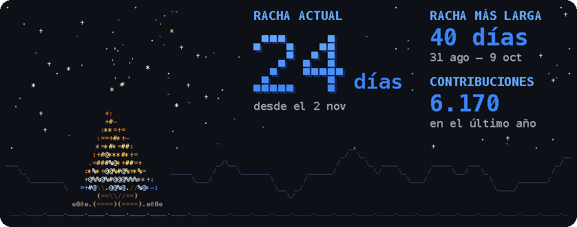
</picture>
<picture>
  <source media="(prefers-color-scheme: dark)" srcset="assets/blue-langs-dark.gif" />
  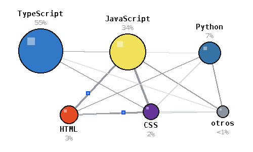
</picture>
<picture>
  <source media="(prefers-color-scheme: dark)" srcset="assets/blue-flame-dark.gif" />
  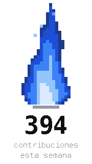
</picture>

<picture>
  <source media="(prefers-color-scheme: dark)" srcset="assets/blue-city-dark.gif" />
  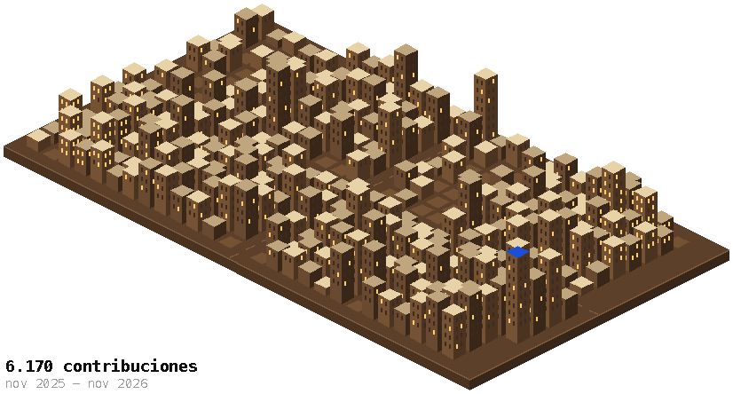
</picture>
<picture>
  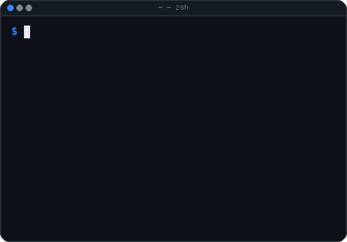
</picture>

<picture>
  <source media="(prefers-color-scheme: dark)" srcset="assets/blue-lorenz-ascii-dark.gif" />
  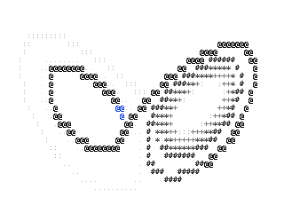
</picture>
<picture>
  <source media="(prefers-color-scheme: dark)" srcset="assets/blue-dna-helix-dark.gif" />
  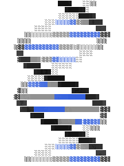
</picture>
<picture>
  <source media="(prefers-color-scheme: dark)" srcset="assets/blue-mandelbrot-zoom-dark.gif" />
  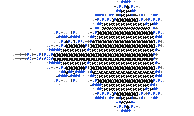
</picture>
<picture>
  <source media="(prefers-color-scheme: dark)" srcset="assets/blue-atom-orbits-dark.gif" />
  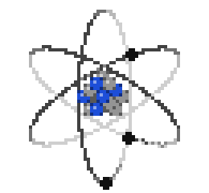
</picture>
<picture>
  <source media="(prefers-color-scheme: dark)" srcset="assets/blue-double-pendulum-dark.gif" />
  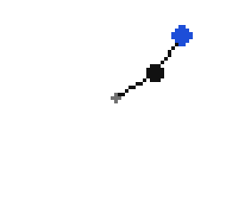
</picture>

<picture>
  <source media="(prefers-color-scheme: dark)" srcset="assets/blue-circuit-dark.gif" />
  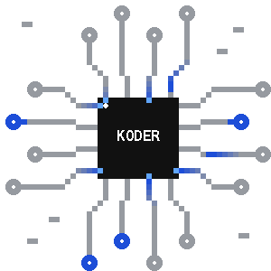
</picture>
<picture>
  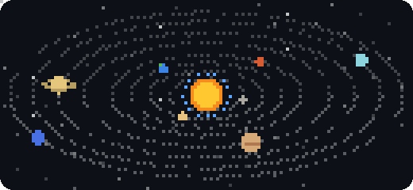
</picture>
<picture>
  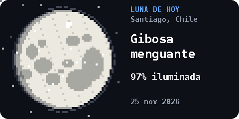
</picture>
<picture>
  <source media="(prefers-color-scheme: dark)" srcset="assets/blue-barnsley-fern-dark.gif" />
  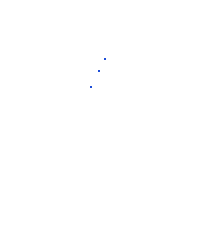
</picture>

<a href="https://github.com/FranciscoYuster?tab=achievements">
  <picture>
    <source media="(prefers-color-scheme: dark)" srcset="assets/medals-spin-4-dark.gif" />
    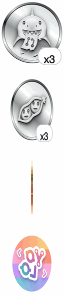
  </picture>
</a>

<picture>
  <source media="(prefers-color-scheme: dark)" srcset="assets/blue-deck-dark.gif" />
  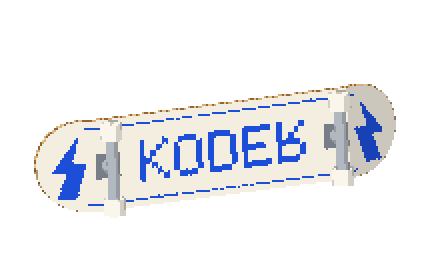
</picture>
<picture>
  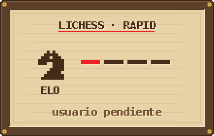
</picture>
<picture>
  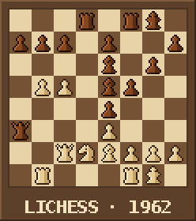
</picture>
<picture>
  <source media="(prefers-color-scheme: dark)" srcset="assets/blue-bonsai-dark.gif" />
  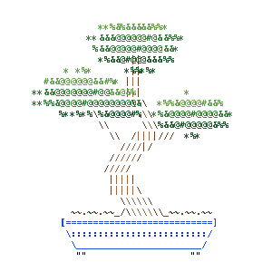
</picture>

<picture>
  <source media="(prefers-color-scheme: dark)" srcset="assets/blue-now-playing-dark.gif" />
  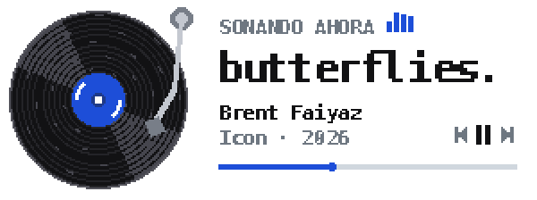
</picture>
<picture>
  <source media="(prefers-color-scheme: dark)" srcset="assets/blue-coffee-dark.gif" />
  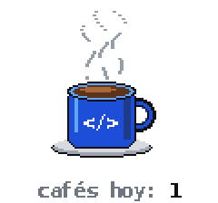
</picture>
<picture>
  <source media="(prefers-color-scheme: dark)" srcset="assets/blue-element-of-the-day-dark.gif" />
  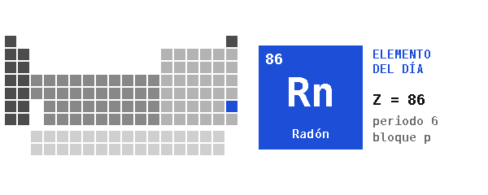
</picture>

<a href="https://github.com/FranciscoYuster?tab=achievements"><picture><source media="(prefers-color-scheme: dark)" srcset="assets/blue-achievement-pull-shark-dark.gif" /></picture></a><a href="https://github.com/FranciscoYuster?tab=achievements"><picture><source media="(prefers-color-scheme: dark)" srcset="assets/blue-achievement-pair-extraordinaire-dark.gif" />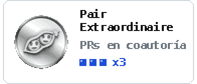</picture></a><a href="https://github.com/FranciscoYuster?tab=achievements"><picture><source media="(prefers-color-scheme: dark)" srcset="assets/blue-achievement-quickdraw-dark.gif" />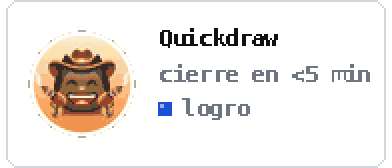</picture></a><a href="https://github.com/FranciscoYuster?tab=achievements"><picture><source media="(prefers-color-scheme: dark)" srcset="assets/blue-achievement-yolo-dark.gif" /></picture></a>

## Tecnologías

| Área | Stack |
| :--- | :--- |
| **Lenguajes** |        |
| **Frameworks y Librerías** |    |
| **Análisis de Datos** |         |
| **Bases de Datos** |    |
| **Cloud & DevOps** |    |
| **Herramientas** |       ![ChatGPT](https://img.shields.io/badge/ChatGPT-000?logo=data:image/svg%2Bxml;base64,PHN2ZyBmaWxsPSIjNzRBQTlDIiB2aWV3Qm94PSIwIDAgMjQgMjQiIHhtbG5zPSJodHRwOi8vd3d3LnczLm9yZy8yMDAwL3N2ZyI%2BPHBhdGggZD0iTTIyLjI4MTkgOS44MjExYTUuOTg0NyA1Ljk4NDcgMCAwIDAtLjUxNTctNC45MTA4IDYuMDQ2MiA2LjA0NjIgMCAwIDAtNi41MDk4LTIuOUE2LjA2NTEgNi4wNjUxIDAgMCAwIDQuOTgwNyA0LjE4MThhNS45ODQ3IDUuOTg0NyAwIDAgMC0zLjk5NzcgMi45IDYuMDQ2MiA2LjA0NjIgMCAwIDAgLjc0MjcgNy4wOTY2IDUuOTggNS45OCAwIDAgMCAuNTExIDQuOTEwNyA2LjA1MSA2LjA1MSAwIDAgMCA2LjUxNDYgMi45MDAxQTUuOTg0NyA1Ljk4NDcgMCAwIDAgMTMuMjU5OSAyNGE2LjA1NTcgNi4wNTU3IDAgMCAwIDUuNzcxOC00LjIwNTggNS45ODk0IDUuOTg5NCAwIDAgMCAzLjk5NzctMi45MDAxIDYuMDU1NyA2LjA1NTcgMCAwIDAtLjc0NzUtNy4wNzI5em0tOS4wMjIgMTIuNjA4MWE0LjQ3NTUgNC40NzU1IDAgMCAxLTIuODc2NC0xLjA0MDhsLjE0MTktLjA4MDQgNC43NzgzLTIuNzU4MmEuNzk0OC43OTQ4IDAgMCAwIC4zOTI3LS42ODEzdi02LjczNjlsMi4wMiAxLjE2ODZhLjA3MS4wNzEgMCAwIDEgLjAzOC4wNTJ2NS41ODI2YTQuNTA0IDQuNTA0IDAgMCAxLTQuNDk0NSA0LjQ5NDR6bS05LjY2MDctNC4xMjU0YTQuNDcwOCA0LjQ3MDggMCAwIDEtLjUzNDYtMy4wMTM3bC4xNDIuMDg1MiA0Ljc4MyAyLjc1ODJhLjc3MTIuNzcxMiAwIDAgMCAuNzgwNiAwbDUuODQyOC0zLjM2ODV2Mi4zMzI0YS4wODA0LjA4MDQgMCAwIDEtLjAzMzIuMDYxNUw5Ljc0IDE5Ljk1MDJhNC40OTkyIDQuNDk5MiAwIDAgMS02LjE0MDgtMS42NDY0ek0yLjM0MDggNy44OTU2YTQuNDg1IDQuNDg1IDAgMCAxIDIuMzY1NS0xLjk3MjhWMTEuNmEuNzY2NC43NjY0IDAgMCAwIC4zODc5LjY3NjVsNS44MTQ0IDMuMzU0My0yLjAyMDEgMS4xNjg1YS4wNzU3LjA3NTcgMCAwIDEtLjA3MSAwbC00LjgzMDMtMi43ODY1QTQuNTA0IDQuNTA0IDAgMCAxIDIuMzQwOCA3Ljg3MnptMTYuNTk2MyAzLjg1NThMMTMuMTAzOCA4LjM2NCAxNS4xMTkyIDcuMmEuMDc1Ny4wNzU3IDAgMCAxIC4wNzEgMGw0LjgzMDMgMi43OTEzYTQuNDk0NCA0LjQ5NDQgMCAwIDEtLjY3NjUgOC4xMDQydi01LjY3NzJhLjc5Ljc5IDAgMCAwLS40MDctLjY2N3ptMi4wMTA3LTMuMDIzMWwtLjE0Mi0uMDg1Mi00Ljc3MzUtMi43ODE4YS43NzU5Ljc3NTkgMCAwIDAtLjc4NTQgMEw5LjQwOSA5LjIyOTdWNi44OTc0YS4wNjYyLjA2NjIgMCAwIDEgLjAyODQtLjA2MTVsNC44MzAzLTIuNzg2NmE0LjQ5OTIgNC40OTkyIDAgMCAxIDYuNjgwMiA0LjY2ek04LjMwNjUgMTIuODYzbC0yLjAyLTEuMTYzOGEuMDgwNC4wODA0IDAgMCAxLS4wMzgtLjA1NjdWNi4wNzQyYTQuNDk5MiA0LjQ5OTIgMCAwIDEgNy4zNzU3LTMuNDUzN2wtLjE0Mi4wODA1TDguNzA0IDUuNDU5YS43OTQ4Ljc5NDggMCAwIDAtLjM5MjcuNjgxM3ptMS4wOTc2LTIuMzY1NGwyLjYwMi0xLjQ5OTggMi42MDY5IDEuNDk5OHYyLjk5OTRsLTIuNTk3NCAxLjQ5OTctMi42MDY3LTEuNDk5N1oiLz48L3N2Zz4=)    |

---

Koder SpA · <a href="https://www.dilerlatam.com">dilerlatam.com</a> · <a href="https://www.linkedin.com/in/francisco-yuster-aa0b06258/">LinkedIn</a>

